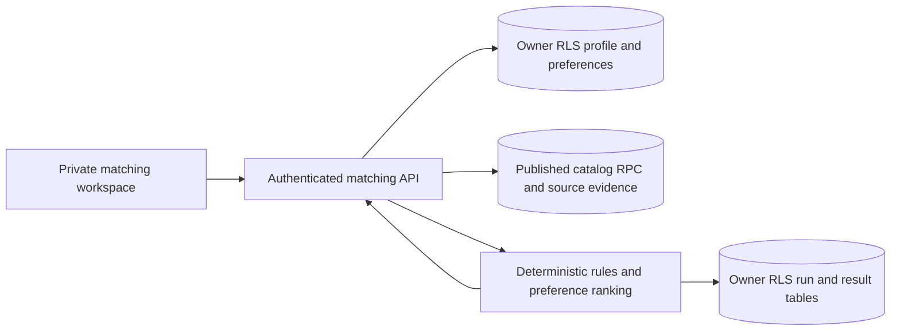

# Phase 16 matching architecture — 2026-10-25

Status: **PARTIAL**. The engine and schema are implemented against the authorized Jetuu development project. Its real reviewed corpus has zero programs and scholarships, and hosted Auth/REST traffic is blocked from this workspace. No live student recommendation has been verified.

## Request and trust boundaries

`/{locale}/match` is a private Next.js workspace. `POST /api/matching/run` rejects cross-origin requests, oversized/non-JSON/invalid preferences, and unauthenticated users. The server obtains the user ID from `auth.getUser()`; it never accepts a profile ID from the browser. A request-scoped Supabase client reads the student's owner-RLS profile and existing published `unified_catalog_search` results. Batched bounded reads attach normalized requirements, source claims, deadlines, tuition, and scholarship benefits. Only the authorized development project received the three additive migrations. No service-role key is used in this flow.

## Rule contract and source policy

Each evaluated rule has an ID, `MET`/`NOT_MET`/`UNKNOWN`/`NOT_APPLICABLE`, requirement text, explanation, source URL, verification state, UTC evaluation timestamp, and mandatory flag. `NOT_MET` on a mandatory current verified rule produces **not eligible based on known requirements**. Known matches with unknown mandatory rules produce **potentially eligible**; no known matches produce **insufficient information**. A fully known set may produce **eligible based on known requirements**. All categories are guidance, never admissions decisions.

Only structured, source-backed conditions can pass/fail: citizenship/residency lists, a single supported prior-degree requirement, same-scale GPA, overall exam thresholds with no unresolved component/alternative rule, and a directly sourced current deadline. Missing, unverified, stale, conflicting, ambiguous, text-only, and unsupported conditions yield UNKNOWN. Self-reported scores are always unverified when loaded from the user-editable profile, even if its JSON says otherwise. Scholarship program linkage is UNKNOWN until a specific program relation can be proven for the student. Verified benefit components are listed separately; no full-funding label is inferred. Program language, enrollment term, gap year, waiver decisions, currency conversion, total cost and additional qualifications need curated normalized evidence before they can become hard pass/fail rules.

The freshness window is currently 180 days from official-source review. Active and effective date windows are checked. Deadline proof requires a claim on the exact deadline entity and matching timestamp/type. If evidence is incomplete, the date may still be displayed as a catalog fact but the eligibility rule is UNKNOWN. Duplicate or conflicting claims fail closed to conflicted/UNKNOWN. Published search remains the first visibility gate.

## Ranking and limits

`matching-v2` uses fixed possible points: major 20, country 15, teaching language 15, degree 15, verified tuition-funding component 15, and sourced annual USD tuition versus the student's stated budget 20. A factor contributes to the assessed weight only when both sides are known. The displayed value is earned points out of 100 plus assessed weight out of 100, not an admission probability or a normalized percentage. This permits a reader to see missing-data sensitivity. Funding and budget are separate from eligibility and from each other. Stable order is eligibility category, earned points, assessed weight, entity type, then entity ID; an unmet mandatory requirement always sorts below unknown/eligible cases. Program interest text currently uses a literal case-insensitive substring; no semantic inference is claimed. The active DB config must exactly match code weights/version or requests fail closed.

At most 30 programs and 20 scholarships are considered per run; related reads have hard caps and fail closed if a cap is hit. There is a 12-second service timeout, 30-second per-user cooldown, and 20 runs per user per day enforced in the service and database. The first-page title sort is a deliberate bounded MVP tradeoff, not an exhaustive global top-50 recommendation. The catalog may change after a run; GET validates profile/rules version and saved row count, then recalculates from current published data using the saved preference snapshot. No shared personalized cache is used.

## Persistence and privacy

`matching_preferences` stores each user's JSON preferences; `matching_runs` stores profile/rules version, preference snapshot, candidate count, and timestamp; `matching_results` stores owner-scoped result snapshots; `matching_configuration` stores immutable versioned weights. Foreign keys, constraints, explicit grants, trigger limits, and owner RLS protect the three private tables. These are user-readable private records, not trusted sources for public catalog facts. GET recomputes instead of trusting the user-writable result JSON. A failed multi-request write can leave an incomplete run; GET rejects it by count. A future server-only atomic transaction/RPC would improve this boundary. No student profile or result is sent to an external AI provider and no AI-generated response is claimed. An optional explanation service requires separate provider configuration, schema validation, minimized data, prompt isolation, and cost limits before activation.

## Tests and release gates

Unit fixtures cover missing data, citizenship mismatch, unverified/expired tests, stale sources, deadline, GPA scale, scholarship unknown linkage, deterministic ranking, and profile merge. Cloud transactional SQL exercised 18 RLS/grant/ownership assertions and rolled back fixtures. Full Chromium regression passed 64 desktop/mobile cases with four Auth-dependent skips. API/browser tests cover cross-origin and malformed requests; live authenticated matching is skipped without reachable Auth. The real development catalog has zero programs and scholarships, so live recommendations, source correctness and cross-device profile-to-match journeys remain unverified. Phase 16 stays PARTIAL until a small reviewed corpus and reachable hosted Auth/REST or an equivalent disposable full stack can exercise the entire flow.
