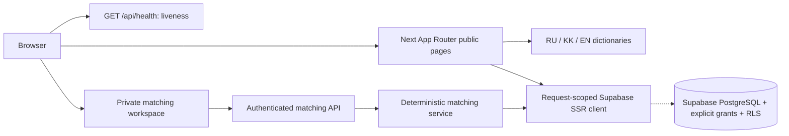

# Architecture — current JETU application and Phase 16 matching

Phase 16.5 keeps official-source samples in the existing normalized catalog as
`draft`/`needs_review`. The editorial staging SQL is idempotent and never
publishes. Public search and matching continue to read only the published
catalog; see `DATA_VERIFICATION.md` for the review gate.

## State and boundaries

The root is a single Next.js package, not a monorepo. `jetu/` is a preserved upload
snapshot with an empty package manifest, not another executable app. Earlier
architecture documents were empty, so there is no verified Phase 03 design to replace.
The application has public catalog/search and private profile, save, comparison,
and matching flows. Their phase verification statuses are tracked separately.

The application uses request-scoped Supabase clients, explicit grants and owner
RLS for private writes. The matching API reads published catalog facts and saves
private runs; browser memory is never the persistence layer.

## Implemented modules

| Path                       | Responsibility                                                                    | Boundary                                                                     |
| -------------------------- | --------------------------------------------------------------------------------- | ---------------------------------------------------------------------------- |
| `src/app/(marketing)`      | Public localized marketing/info routes, design gallery, SEO, boundaries, liveness | Read-only product reads via catalog feature; no product mutation             |
| `src/features/catalog`     | Read-only catalog server access and localized views                               | Anon-key RPC `catalog_search`/REST GET only; no writes                       |
| `src/app/(auth)`           | Registration, sign-in, password reset and callback/confirm routes                 | Zod-validated server actions; no product tables                              |
| `src/app/(dashboard)`      | Private workspace: account card and student-profile form                          | Owner-RLS `student_profiles` reads/writes after identity check               |
| `src/components/marketing` | Leaf concept preview, locale nav, footer and JSON-LD                              | Demo state only; no business-data fetch                                      |
| `src/proxy.ts`             | Locale header, session refresh, route-set 404 guard                               | Overwrites caller header; assets skip auth work                              |
| `src/components/ui`        | Leaf language interaction using Motion                                            | Public data only; SSR content works without JS                               |
| `src/lib/env`              | Zod validation and privileged env isolation                                       | Optional absent config; malformed/partial config fails closed                |
| `src/lib/supabase`         | Typed browser/SSR/admin factories                                                 | SSR per request, cookie/cache propagation; admin server-only                 |
| `src/lib/i18n`             | Typed RU/KK/EN copy registries (marketing, auth, catalog, messages)               | Copy only; no env, DB or secrets                                             |
| `src/domain`               | Discriminated Result, error/status taxonomy                                       | No framework or credentials                                                  |
| `src/server`               | JSON HTTP contract                                                                | Server-generated request IDs, no-store, sanitized error messages             |
| `scripts/db*`              | Strict local-only CLI command allowlist                                           | No remote selectors/flags/linked project; Linux socket or Windows named pipe |
| `supabase`                 | CLI config, migrations, seed, SQL security tests                                  | RLS + explicit opt-in grants per exposed table; unexposed private schema     |

No Edge Functions, background jobs, queues, payments, external AI provider,
or tenant claims are used by matching. Profile, catalog, saves and comparison
exist, but several phase acceptance gates remain open. The personal roadmap
and application planner have not started.

## Phase 15 unified discovery boundary

`src/features/search` owns a discriminated public search contract for
`program | scholarship | opportunity`. Server components parse URL state with
Zod and call `unified_catalog_search` over the public Supabase key with
`cache: no-store`; autocomplete uses the same bounded RPC through
`/api/search/suggest`. Stable identity is `entity_type + entity_id`, pages contain
20 rows, suggestions eight, and comparison accepts two to four unique program
IDs. Scholarship and opportunity detail pages expose only published,
source-backed fields.

The RPC is `SECURITY INVOKER`: catalog RLS remains authoritative for results,
counts, autocomplete and comparison. It preaggregates verified evidence,
deadline, tuition, language/mode and funding facts before joining the three
entity branches. FTS (`simple`) and trigram indexes support Latin, Cyrillic,
Kazakh and diacritic queries; all filters and sort keys come from fixed
allowlists. There is no cross-request result cache that could outlive a
publication change.

`saved_catalog_items` and `saved_searches` are private owner-RLS tables.
Authenticated server actions re-read the current user for every mutation;
unique `(user_id, catalog_entity_id)` and `(user_id, fingerprint)` constraints
make saves race-safe and idempotent. Comparison is a read-only normalized table
with explicit unknown/not-evaluated values, never a Phase 16 match score.

## HTTP / failure contract

`GET /api/health` returns `{data:{status:'ok'},requestId}` and does not probe Supabase.
Unsupported methods get Next's 405. Success and errors are mutually exclusive.
Errors contain a fixed safe message, code, request ID, optional caller-validated
field errors, and matching HTTP status. Never serialize a database or SDK exception.
Public pages need no backend, so a missing integration does not masquerade as a
healthy database or fake a persistence response.

## Rendering / localization

Server components render public content and private page shells. Leaf client components handle matching preferences/results, search autocomplete, and existing interaction feedback. Locale comes from the validated URL, propagated by
the Next proxy to `<html lang>`. The root layout reads request headers, so these
pages render dynamically; future static marketing optimization needs a reviewed
locale-root routing design. Public URLs contain their locale; private workspace routes read a request-scoped authenticated session. Global 404 uses a safe fallback with home links.

Phase 05 reconciles the visual contract with the actual July 2026 pitch now in
`docs/pitch/`. Semantic tokens live in `src/styles/tokens.css`; shared primitives,
original path-drawn brand assets and interactions live in `src/components/ui/`.
Approved web blue/yellow remain; contrast-safe primary/on-brand variants support
small labels. Light-only contract: `design-system/jetu-admissions/MASTER.md`.
Motion language press and CSS feedback never delay visible content.

Historically, Phase 06 replaced the availability splash with a localized marketing home and
12 informational paths per locale. Server-rendered copy and metadata use one typed
RU/KK/EN content registry; only the explicitly labeled demo tabs and language
navigation hydrate. That Phase 06 snapshot preceded the later catalog, signup, profile, save, and matching modules. Checkout, AI requests and contact submission remain unavailable. All enabled links
lead to real localized information paths. The existing `loading.tsx` and error
boundary handle route transitions; page and footer render in the same stream segment
so the footer does not jump when main content arrives (local Lighthouse CLS 0).

The canonical origin is `NEXT_PUBLIC_APP_URL`. Page metadata includes canonical,
RU/KK/EN alternates, OG/Twitter text and the original generated PNG image. Sitemap,
robots, WebSite and FAQPage data expose only static factual content. Indexing is
off unless `JETU_PUBLIC_INDEXING=true` and the origin is nonlocal; this prevents
preview/staging URLs from being indexed by default. `src/proxy.ts` validates the
current public path allowlist and returns a real localized HTTP 404 before React
streaming for unknown paths. Future routes must be added to that allowlist when
their phases introduce them. Locale header replacement remains independent of auth.

`/{locale}/design-system` is public noindex documentation: a server route passes
one validated locale dictionary to a leaf interactive playground. Its real section
registry provides filters, sorting and spotlight navigation. The typography form
validates locally with Zod and never sends/persists input. No API, product record or
DB dependency was added. No-JS content/links work; SSR-disabled preview controls
become interactive only after hydration. Loading/error specimens are labeled.

Native HTML dialog supplies top-layer/inert/Escape/focus-restoration behavior;
explicit Tab/Shift+Tab cycling keeps focus inside. Tabs use roving focus and
Home/End/arrows. Tooltip supports focus/hover/tap/Escape. Native fields/selects
own control semantics; form errors use a named focusable summary and inline IDs.
Automatic loading is scoped to `(marketing)/loading.tsx`, so an ancestor streaming
fallback cannot hide documentation content when JavaScript is disabled.

## Database / security

Migration `20261018072531_foundation_security.sql` creates only the unexposed
`jetu_private` schema. It removes public schema CREATE and implicit access to future
Postgres-owned tables/sequences/functions; PostgreSQL global PUBLIC EXECUTE is
revoked separately because a schema-scoped revoke cannot undo that global default.
New tables must enable RLS before any explicit grant. At that historical baseline no application tables existed. Later migrations add the catalog and private product tables. SQL tests use transactional throwaway objects, not persistent business fixtures.

Admin secrets never enter public modules. The current admin factory accepts modern
`sb_secret_` keys; the browser supports publishable keys or legacy local anon JWTs.
JWT inspection here validates configuration format only, not a user's identity.
Phase 08 added Auth refresh and identity checks; its full phase acceptance remains unverified.

Keep development, staging and production projects separate. Local CLI scripts check
dotenv-loaded env, fixed project identity, API exposure defaults, linked metadata,
and Docker selectors, then append `--local` where supported. Types are replaced
atomically after successful local generation and formatting. The wrapper provides no
remote command. The user-authorized existing Jetuu project is accessed separately
through explicit MCP calls; see CLOUD_DEVELOPMENT.md. It is not an isolated branch.

## Phase 12 catalog read path — 2026-10-21

The development database contains the normalized Phase 10 catalog (migration files recovered from its history into this checkout); the original architecture note above predates that remote schema. Phase 12 adds a single `SECURITY INVOKER` search RPC over the existing canonical relationships. Public search and detail reads use the publishable key only, explicit grants and existing RLS. They cannot write. Source claims and publication state gate results. REST access is server-side, request-scoped and `no-store`; URL query parameters are the search state. RU/KK/EN detail pages expose source date, costs with currency/period/as-of, requirements, intakes and linked funding where published. At Phase 12 this was true; Phase 15 added save and compare. A personal plan is still absent.

The cloud SQL call worked; a direct REST tunnel from this workspace returned HTTP proxy CONNECT 403. The app therefore renders the unavailable state here. Real data read-path and performance at scale are still open verification gates.

## Phase 16 matching addition — 2026-10-25

The private `/{locale}/match` route calls `GET/POST /api/matching/run`. A request-scoped authenticated Supabase client reads owner-RLS profile/preferences and bounded published catalog rows. `src/features/matching/service.ts` batches normalized requirement, deadline, scholarship-benefit and official-source reads; `engine.ts` evaluates source-gated mandatory rules separately from fixed-weight preference ranking. `matching_preferences`, `matching_runs`, `matching_results` and versioned `matching_configuration` are additive development tables. No browser privileged key or external AI service is used. See `AI_MATCHING_ARCHITECTURE.md` for trust, rule, cache, freshness and transaction limits. The opening diagram includes the current private flow.
