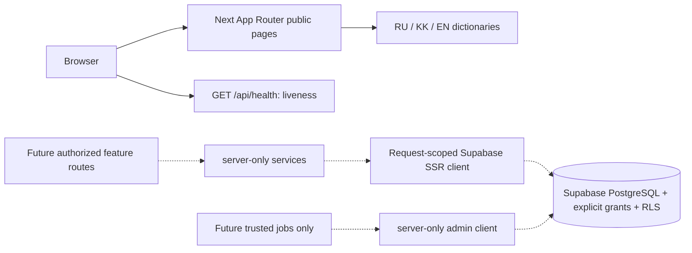

# Architecture — foundation through Phase 14 additions

Earlier future-tense sections are historical checkpoint descriptions. The Phase 14 addendum at the end records the current opportunities boundary.

## State and boundaries

The root is a single Next.js package, not a monorepo. `jetu/` is a preserved upload
snapshot with an empty package manifest, not another executable app. Earlier
architecture documents were empty, so there is no verified Phase 03 design to replace.
This document records implemented foundation boundaries only, not completed domain flows.

Solid arrows are implemented request flows. Dotted arrows are future integrations;
no feature API currently reads or writes student/catalog data. Supabase PostgreSQL
will own durable product state; browser memory is never a persistence substitute.

## Implemented modules

| Path                       | Responsibility                                                                    | Boundary                                                                     |
| -------------------------- | --------------------------------------------------------------------------------- | ---------------------------------------------------------------------------- |
| `src/app/(marketing)`      | Public localized marketing/info routes, design gallery, SEO, boundaries, liveness | Read-only product reads via catalog feature; no product mutation             |
| `src/features/catalog`     | Read-only catalog server access and localized views                               | Anon-key RPC `catalog_search`/REST GET only; no writes                       |
| `src/app/(auth)`           | Registration, sign-in, password reset and callback/confirm routes                 | Zod-validated server actions; no product tables                              |
| `src/app/(dashboard)`      | Private workspace: account card and student-profile form                          | Owner-RLS `student_profiles` reads/writes after identity check               |
| `src/components/marketing` | Leaf concept preview, locale nav, footer and JSON-LD                              | Demo state only; no business-data fetch                                      |
| `src/proxy.ts`             | Locale header, session refresh, route-set 404 guard                               | Overwrites caller header; assets skip auth work                              |
| `src/components/ui`        | Leaf language interaction using Motion                                            | Public data only; SSR content works without JS                               |
| `src/lib/env`              | Zod validation and privileged env isolation                                       | Optional absent config; malformed/partial config fails closed                |
| `src/lib/supabase`         | Typed browser/SSR/admin factories                                                 | SSR per request, cookie/cache propagation; admin server-only                 |
| `src/lib/i18n`             | Typed RU/KK/EN copy registries (marketing, auth, catalog, messages)               | Copy only; no env, DB or secrets                                             |
| `src/domain`               | Discriminated Result, error/status taxonomy                                       | No framework or credentials                                                  |
| `src/server`               | JSON HTTP contract                                                                | Server-generated request IDs, no-store, sanitized error messages             |
| `scripts/db*`              | Strict local-only CLI command allowlist                                           | No remote selectors/flags/linked project; Linux socket or Windows named pipe |
| `supabase`                 | CLI config, migrations, seed, SQL security tests                                  | RLS + explicit opt-in grants per exposed table; unexposed private schema     |

No Edge Functions, background jobs, caches, queues, payments, AI providers, external
mail, buckets, or tenant claims are implemented yet. Student-profile persistence and
the read-only catalog explorer exist; their phase acceptance is not verified. RLS
policies and per-user authorization remain mandatory before exposing any new
product table. Unsupported save/compare/plan controls do not exist and are not
rendered.

## HTTP / failure contract

`GET /api/health` returns `{data:{status:'ok'},requestId}` and does not probe Supabase.
Unsupported methods get Next's 405. Success and errors are mutually exclusive.
Errors contain a fixed safe message, code, request ID, optional caller-validated
field errors, and matching HTTP status. Never serialize a database or SDK exception.
Public pages need no backend, so a missing integration does not masquerade as a
healthy database or fake a persistence response.

## Rendering / localization

Server components render all content. Only language press feedback and error/loading
boundaries require client code. Locale comes from the validated URL, propagated by
the Next proxy to `<html lang>`. The root layout reads request headers, so these
pages render dynamically; future static marketing optimization needs a reviewed
locale-root routing design. Public URLs contain their locale; no session cookie
or sensitive state is read here. Global 404 uses a safe fallback with home links.

Phase 05 reconciles the visual contract with the actual July 2026 pitch now in
`docs/pitch/`. Semantic tokens live in `src/styles/tokens.css`; shared primitives,
original path-drawn brand assets and interactions live in `src/components/ui/`.
Approved web blue/yellow remain; contrast-safe primary/on-brand variants support
small labels. Light-only contract: `design-system/jetu-admissions/MASTER.md`.
Motion language press and CSS feedback never delay visible content.

Phase 06 replaces the availability splash with a localized marketing home and
12 informational paths per locale. Server-rendered copy and metadata use one typed
RU/KK/EN content registry; only the explicitly labeled demo tabs and language
navigation hydrate. There is no scholarship listing, AI request, student profile,
checkout, signup or contact submission. Calls to those features would be misleading
until their domain modules and access controls are implemented. All enabled links
lead to real localized information paths. The existing `loading.tsx` and error
boundary handle route transitions; page and footer render in the same stream segment
so the footer does not jump when main content arrives (local Lighthouse CLS 0).

The canonical origin is `NEXT_PUBLIC_APP_URL`. Page metadata includes canonical,
RU/KK/EN alternates, OG/Twitter text and the original generated PNG image. Sitemap,
robots, WebSite and FAQPage data expose only static factual content. Indexing is
off unless `JETU_PUBLIC_INDEXING=true` and the origin is nonlocal; this prevents
preview/staging URLs from being indexed by default. `src/proxy.ts` validates the
current public path allowlist and returns a real localized HTTP 404 before React
streaming for unknown paths. Future routes must be added to that allowlist when
their phases introduce them. Locale header replacement remains independent of auth.

`/{locale}/design-system` is public noindex documentation: a server route passes
one validated locale dictionary to a leaf interactive playground. Its real section
registry provides filters, sorting and spotlight navigation. The typography form
validates locally with Zod and never sends/persists input. No API, product record or
DB dependency was added. No-JS content/links work; SSR-disabled preview controls
become interactive only after hydration. Loading/error specimens are labeled.

Native HTML dialog supplies top-layer/inert/Escape/focus-restoration behavior;
explicit Tab/Shift+Tab cycling keeps focus inside. Tabs use roving focus and
Home/End/arrows. Tooltip supports focus/hover/tap/Escape. Native fields/selects
own control semantics; form errors use a named focusable summary and inline IDs.
Automatic loading is scoped to `(marketing)/loading.tsx`, so an ancestor streaming
fallback cannot hide documentation content when JavaScript is disabled.

## Database / security

Migration `20261018072531_foundation_security.sql` creates only the unexposed
`jetu_private` schema. It removes public schema CREATE and implicit access to future
Postgres-owned tables/sequences/functions; PostgreSQL global PUBLIC EXECUTE is
revoked separately because a schema-scoped revoke cannot undo that global default.
New tables must enable RLS before any explicit grant. No current application
tables exist. SQL tests use transactional throwaway objects, not business fixtures.

Admin secrets never enter public modules. The current admin factory accepts modern
`sb_secret_` keys; the browser supports publishable keys or legacy local anon JWTs.
JWT inspection here validates configuration format only, not a user's identity.
Auth refresh and identity/role enforcement are intentionally not claimed before Phase 08.

Keep development, staging and production projects separate. Local CLI scripts check
dotenv-loaded env, fixed project identity, API exposure defaults, linked metadata,
and Docker selectors, then append `--local` where supported. Types are replaced
atomically after successful local generation and formatting. The wrapper provides no
remote command. The user-authorized existing Jetuu project is accessed separately
through explicit MCP calls; see CLOUD_DEVELOPMENT.md. It is not an isolated branch.

## Phase 12 catalog read path — 2026-10-21

The development database contains the normalized Phase 10 catalog (migration files recovered from its history into this checkout); the original architecture note above predates that remote schema. Phase 12 adds a single `SECURITY INVOKER` search RPC over the existing canonical relationships. Public search and detail reads use the publishable key only, explicit grants and existing RLS. They cannot write. Source claims and publication state gate results. REST access is server-side, request-scoped and `no-store`; URL query parameters are the search state. RU/KK/EN detail pages expose source date, costs with currency/period/as-of, requirements, intakes and linked funding where published. No Auth-derived save, compare or plan action exists yet.

## Phase 14 opportunity path — updated 2026-10-24

The connected development database had already applied the Phase 13 prerequisite migrations and two Phase 14 migrations. Their exact stored statements are recovered under their original versions in `supabase/migrations/`; no duplicate Phase 14 schema was applied. The canonical `opportunities` row contains sourced eligibility, age/grade, location/format, cost, host, application and risk facts. `institution_school_profiles` separately classifies schools and partnership state; no B2B tenant grant is implied. `opportunity_search(jsonb)` is a bounded `SECURITY INVOKER` RPC and requires published, verified, recent official evidence. The localized public routes call it with URL filters through the publishable key. Authenticated server actions validate the user, resolve a visible opportunity, then write only to owner-RLS `student_opportunity_saves` or `student_opportunity_plan_actions`. The latter has a version check to reject concurrent updates. Choosing Saved inserts/retains a save and removes the existing versioned plan. The private dashboard reads at most 50 saves and 50 plan actions. The Next proxy explicitly allows the opportunity detail and owner workspace routes.

One 2027 Blue Planet Awareness Contest record was published after checking the official organizer pages; its source claims and date are preserved in `supabase/content/20261024_blue_planet_2027.sql`. A separate `/{locale}/schools` route reads 12 school profiles per page (max page 200) and intersects public RLS-visible institutions, verified claims and active official sources checked within 180 days. It excludes university institution types and reveals partner status only when the profile is marked verified. There are no school rows yet. The local workspace still receives proxy CONNECT 403 to Supabase, but the deployed preview and ephemeral Vercel sandbox proved the live Auth, REST, RLS and Next server-action path. Scale performance and production promotion are not claimed.
