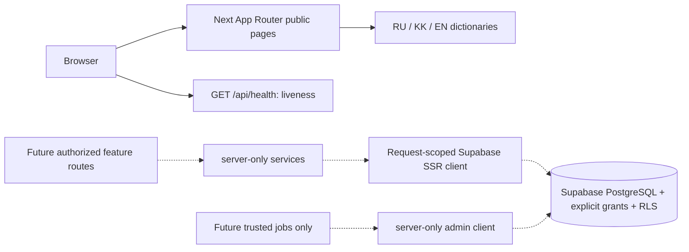

# Architecture — foundation, design system and Phase 06 public site

## State and boundaries

The root is a single Next.js package, not a monorepo. `jetu/` is a preserved upload
snapshot with an empty package manifest, not another executable app. Earlier
architecture documents were empty, so there is no verified Phase 03 design to replace.
This document records implemented foundation boundaries only, not completed domain flows.

Solid arrows are implemented request flows. Dotted arrows are future integrations;
no feature API currently reads or writes student/catalog data. Supabase PostgreSQL
will own durable product state; browser memory is never a persistence substitute.

## Implemented modules

| Path                       | Responsibility                                                                    | Boundary                                                         |
| -------------------------- | --------------------------------------------------------------------------------- | ---------------------------------------------------------------- |
| `src/app`                  | Public localized marketing/info routes, design gallery, SEO, boundaries, liveness | No product mutation/data access                                  |
| `src/components/marketing` | Leaf concept preview, locale nav, footer and JSON-LD                              | Demo state only; no business-data fetch                          |
| `src/proxy.ts`             | Validated locale request header                                                   | Overwrites caller header; no auth claim                          |
| `src/components/ui`        | Leaf language interaction using Motion                                            | Public data only; SSR content works without JS                   |
| `src/lib/env`              | Zod validation and privileged env isolation                                       | Optional absent config; malformed/partial config fails closed    |
| `src/lib/supabase`         | Typed browser/SSR/admin factories                                                 | SSR per request, cookie/cache propagation; admin server-only     |
| `src/domain`               | Discriminated Result, error/status taxonomy                                       | No framework or credentials                                      |
| `src/server`               | JSON HTTP contract                                                                | Server-generated request IDs, no-store, sanitized error messages |
| `scripts/db*`              | Strict local-only CLI command allowlist                                           | No remote selectors/flags/linked project/remote daemon           |
| `supabase`                 | CLI config, migration, seed, SQL security tests                                   | Public schema opt-in grants, unexposed private schema            |

No Edge Functions, background jobs, caches, queues, payments, AI providers, external
mail, product tables, buckets, or tenant claims are implemented yet. Their absence
is intentional Phase 04 scope. RLS policies and per-user authorization must be
implemented with the relevant data model before exposing a future feature.

## HTTP / failure contract

`GET /api/health` returns `{data:{status:'ok'},requestId}` and does not probe Supabase.
Unsupported methods get Next's 405. Success and errors are mutually exclusive.
Errors contain a fixed safe message, code, request ID, optional caller-validated
field errors, and matching HTTP status. Never serialize a database or SDK exception.
Public pages need no backend, so a missing integration does not masquerade as a
healthy database or fake a persistence response.

## Rendering / localization

Server components render all content. Only language press feedback and error/loading
boundaries require client code. Locale comes from the validated URL, propagated by
the Next proxy to `<html lang>`. The root layout reads request headers, so these
pages render dynamically; future static marketing optimization needs a reviewed
locale-root routing design. Public URLs contain their locale; no session cookie
or sensitive state is read here. Global 404 uses a safe fallback with home links.

Phase 05 reconciles the visual contract with the actual July 2026 pitch now in
`docs/pitch/`. Semantic tokens live in `src/styles/tokens.css`; shared primitives,
original path-drawn brand assets and interactions live in `src/components/ui/`.
Approved web blue/yellow remain; contrast-safe primary/on-brand variants support
small labels. Light-only contract: `design-system/jetu-admissions/MASTER.md`.
Motion language press and CSS feedback never delay visible content.

Phase 06 replaces the availability splash with a localized marketing home and
12 informational paths per locale. Server-rendered copy and metadata use one typed
RU/KK/EN content registry; only the explicitly labeled demo tabs and language
navigation hydrate. There is no scholarship listing, AI request, student profile,
checkout, signup or contact submission. Calls to those features would be misleading
until their domain modules and access controls are implemented. All enabled links
lead to real localized information paths. The existing `loading.tsx` and error
boundary handle route transitions; page and footer render in the same stream segment
so the footer does not jump when main content arrives (local Lighthouse CLS 0).

The canonical origin is `NEXT_PUBLIC_APP_URL`. Page metadata includes canonical,
RU/KK/EN alternates, OG/Twitter text and the original generated PNG image. Sitemap,
robots, WebSite and FAQPage data expose only static factual content. Indexing is
off unless `JETU_PUBLIC_INDEXING=true` and the origin is nonlocal; this prevents
preview/staging URLs from being indexed by default. `src/proxy.ts` validates the
current public path allowlist and returns a real localized HTTP 404 before React
streaming for unknown paths. Future routes must be added to that allowlist when
their phases introduce them. Locale header replacement remains independent of auth.

`/{locale}/design-system` is public noindex documentation: a server route passes
one validated locale dictionary to a leaf interactive playground. Its real section
registry provides filters, sorting and spotlight navigation. The typography form
validates locally with Zod and never sends/persists input. No API, product record or
DB dependency was added. No-JS content/links work; SSR-disabled preview controls
become interactive only after hydration. Loading/error specimens are labeled.

Native HTML dialog supplies top-layer/inert/Escape/focus-restoration behavior;
explicit Tab/Shift+Tab cycling keeps focus inside. Tabs use roving focus and
Home/End/arrows. Tooltip supports focus/hover/tap/Escape. Native fields/selects
own control semantics; form errors use a named focusable summary and inline IDs.
Automatic loading is scoped to `(marketing)/loading.tsx`, so an ancestor streaming
fallback cannot hide documentation content when JavaScript is disabled.

## Database / security

Migration `20261018072531_foundation_security.sql` creates only the unexposed
`jetu_private` schema. It removes public schema CREATE and implicit access to future
Postgres-owned tables/sequences/functions; PostgreSQL global PUBLIC EXECUTE is
revoked separately because a schema-scoped revoke cannot undo that global default.
New tables must enable RLS before any explicit grant. No current application
tables exist. SQL tests use transactional throwaway objects, not business fixtures.

Admin secrets never enter public modules. The current admin factory accepts modern
`sb_secret_` keys; the browser supports publishable keys or legacy local anon JWTs.
JWT inspection here validates configuration format only, not a user's identity.
Auth refresh and identity/role enforcement are intentionally not claimed before Phase 08.

Keep development, staging and production projects separate. Local CLI scripts check
dotenv-loaded env, fixed project identity, API exposure defaults, linked metadata,
and Docker selectors, then append `--local` where supported. Types are replaced
atomically after successful local generation and formatting. The wrapper provides no
remote command. The user-authorized existing Jetuu project is accessed separately
through explicit MCP calls; see CLOUD_DEVELOPMENT.md. It is not an isolated branch.
